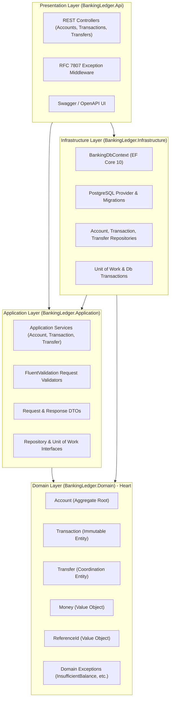

# Banking Ledger Service

[](https://dotnet.microsoft.com/)
[](https://www.postgresql.org/)
[](https://www.docker.com/)
[]()

A robust, enterprise-grade **Banking Ledger API** built following **Domain-Driven Design (DDD)** and **Clean Architecture** principles using **C# .NET 10**, **ASP.NET Core**, **Entity Framework Core (Code-First)**, and **PostgreSQL**.

---

## 🏛️ Architecture & DDD Overview

The solution adheres strictly to **Domain-Driven Design (DDD)** and the **Clean Architecture (Onion Architecture)** pattern, ensuring separation of concerns, testability, and business rule encapsulation.



### Why this design? (Explaining to the Project Manager)
1. **Aggregate Root Guardian (`Account`)**: In banking, balance consistency is non-negotiable. By treating `Account` as the aggregate root, external services cannot modify a customer's balance without generating an immutable `Transaction` record.
2. **Transaction Immutability**: All financial entries are append-only. There are no `PUT`, `PATCH`, or `DELETE` endpoints. If an error occurs in the real world, a compensating counter-transaction is posted.
3. **Atomicity Guarantee**: Single transactions and inter-account transfers run within explicit database transactions (`IUnitOfWork`). If any part fails (such as insufficient balance on a debit), the entire operation rolls back.
4. **Idempotency & Fraud Prevention**: Client-supplied `reference_id` values are constrained by database unique indexes `(AccountId, ReferenceId)`. Retrying a request will never double-charge or double-credit an account.
5. **Human-Readable Comments**: Every layer, class, and critical method includes clear, plain-English comments explaining *why* choices were made.

---

## 🚀 Getting Started

### Prerequisites
- [.NET 10 SDK](https://dotnet.microsoft.com/download) (or .NET 8 / 9)
- [Docker Desktop](https://www.docker.com/products/docker-desktop/) (for local PostgreSQL container)

---

### Option 1: Full Docker Setup (Recommended)
You can spin up both the **PostgreSQL database** and the **Banking Ledger Web API** with a single command:

```bash
docker compose up -d
```

Once started:
- **Interactive Swagger UI:** [http://localhost:5000](http://localhost:5000)
- **Health Check:** [http://localhost:5000/health](http://localhost:5000/health)

To view logs:
```bash
docker compose logs -f api
```

To stop:
```bash
docker compose down
```

---

### Option 2: Run Locally with .NET CLI

1. **Start PostgreSQL via Docker**:
   ```bash
   docker compose up -d postgres
   ```
   *(PostgreSQL will listen on `localhost:5432` with user `postgres`, password `postgres`, database `banking_ledger`)*

2. **Apply Code-First Migrations** (Optional - the app also checks and applies migrations automatically on startup):
   ```bash
   dotnet ef database update -p src/BankingLedger.Infrastructure -s src/BankingLedger.Api
   ```

3. **Run the Web API**:
   ```bash
   dotnet run --project src/BankingLedger.Api
   ```

4. **Open Swagger UI**:
   Navigate to [http://localhost:5000](http://localhost:5000) (or the URL displayed in the terminal).

---

## 🧪 Running Unit Tests

The test suite covers domain invariants, overdraft protection, balance consistency, atomicity, idempotency, and validators.

Run tests via the .NET CLI:
```bash
dotnet test BankingLedger.slnx
```

**Test Results:**
```
Passed! - Failed: 0, Passed: 35, Skipped: 0, Total: 35
```

---

## 📖 API Usage & cURL Examples

### 1. Open an Account
```bash
curl -X POST http://localhost:5000/api/v1/accounts \
  -H "Content-Type: application/json" \
  -d '{
    "accountName": "Alice Johnson",
    "initialBalance": 100.00
  }'
```
*Returns `201 Created` with the new `id` (e.g. `e0b965c4-0822-4467-bc1a-637dc4130091`).*

---

### 2. Check Account Balance
```bash
curl -X GET http://localhost:5000/api/v1/accounts/e0b965c4-0822-4467-bc1a-637dc4130091/balance
```
*Returns:*
```json
{
  "accountId": "e0b965c4-0822-4467-bc1a-637dc4130091",
  "balance": 100.00,
  "timestamp": "2026-10-31T02:00:00Z"
}
```

---

### 3. Post a Credit Transaction
```bash
curl -X POST http://localhost:5000/api/v1/accounts/e0b965c4-0822-4467-bc1a-637dc4130091/transactions \
  -H "Content-Type: application/json" \
  -d '{
    "type": "credit",
    "amount": 50.00,
    "referenceId": "DEP-001",
    "description": "Consulting invoice deposit"
  }'
```
*Returns `201 Created` with updated balance: `150.00`.*

---

### 4. Post a Debit Transaction (With Overdraft Protection)
```bash
curl -X POST http://localhost:5000/api/v1/accounts/e0b965c4-0822-4467-bc1a-637dc4130091/transactions \
  -H "Content-Type: application/json" \
  -d '{
    "type": "debit",
    "amount": 30.00,
    "referenceId": "WDL-001",
    "description": "Office supplies"
  }'
```
*Returns `201 Created` with updated balance: `120.00`.*

*(If amount exceeds balance, returns `422 Unprocessable Entity` with current balance details and no balance change).*

---

### 5. Query Paginated Transactions (Latest-First)
```bash
curl -X GET "http://localhost:5000/api/v1/accounts/e0b965c4-0822-4467-bc1a-637dc4130091/transactions?page=1&limit=10"
```
*Returns transactions sorted strictly by `created_at` latest-first:*
```json
{
  "currentPage": 1,
  "pageSize": 10,
  "totalRecords": 3,
  "totalPages": 1,
  "items": [
    {
      "id": "77aa...",
      "accountId": "e0b965c4-0822-4467-bc1a-637dc4130091",
      "type": "debit",
      "amount": 30.00,
      "referenceId": "WDL-001",
      "balanceAfter": 120.00,
      "createdAt": "2026-10-31T02:15:00Z"
    },
    {
      "id": "88bb...",
      "accountId": "e0b965c4-0822-4467-bc1a-637dc4130091",
      "type": "credit",
      "amount": 50.00,
      "referenceId": "DEP-001",
      "balanceAfter": 150.00,
      "createdAt": "2026-10-31T02:10:00Z"
    },
    {
      "id": "99cc...",
      "accountId": "e0b965c4-0822-4467-bc1a-637dc4130091",
      "type": "credit",
      "amount": 100.00,
      "referenceId": "INIT-E0B965C4",
      "balanceAfter": 100.00,
      "createdAt": "2026-10-31T02:00:00Z"
    }
  ]
}
```

---

### 6. Bonus: Atomic Inter-Account Money Transfer
Transfer \$30 from Account A (balance 100) to Account B (balance 50):

```bash
curl -X POST http://localhost:5000/api/v1/transfers \
  -H "Content-Type: application/json" \
  -d '{
    "sourceAccountId": "e0b965c4-0822-4467-bc1a-637dc4130091",
    "destinationAccountId": "f1a2b3c4-d5e6-7890-abcd-ef0987654321",
    "amount": 30.00,
    "referenceId": "TRF-2026-001",
    "description": "Monthly subscription transfer"
  }'
```
*Returns `200 OK`:*
```json
{
  "id": "11223344-5566-7788-9900-aabbccddeeff",
  "sourceAccountId": "e0b965c4-0822-4467-bc1a-637dc4130091",
  "destinationAccountId": "f1a2b3c4-d5e6-7890-abcd-ef0987654321",
  "amount": 30.00,
  "referenceId": "TRF-2026-001",
  "status": "completed",
  "sourceAccountNewBalance": 70.00,
  "destinationAccountNewBalance": 80.00,
  "createdAt": "2026-10-31T02:20:00Z"
}
```

---

## 🗂️ Project Directory Structure

```
d:\Assignment2\
├── BankingLedger.slnx                       # Solution definition (.NET 10)
├── docker-compose.yml                      # PostgreSQL & Web API container orchestration
├── Dockerfile                              # Multi-stage production container build
├── README.md                               # This documentation
├── scripts/
│   └── init.sql                            # Idempotent database schema with constraints
├── docs/
│   ├── API_DOCUMENTATION.md                # Comprehensive REST API specifications
│   └── ASSUMPTIONS.md                      # Financial ledger assumptions & design decisions
├── src/
│   ├── BankingLedger.Domain/               # Pure C# Domain Layer (Aggregate Root, Entities, Invariants)
│   │   ├── Common/                         # BaseEntity, IAggregateRoot
│   │   ├── Entities/                       # Account, Transaction, Transfer
│   │   ├── Enums/                          # TransactionType, TransferStatus
│   │   ├── Exceptions/                     # InsufficientBalanceException, etc.
│   │   └── ValueObjects/                   # Money, ReferenceId
│   ├── BankingLedger.Application/          # Application Layer (Use cases, DTOs, Validators)
│   │   ├── Common/                         # PagedResult, PaginationParams
│   │   ├── DTOs/                           # AccountDto, TransactionDto, TransferDto
│   │   ├── Interfaces/                     # IAccountRepository, IUnitOfWork, etc.
│   │   ├── Services/                       # AccountService, TransactionService, TransferService
│   │   └── Validators/                     # FluentValidation validators
│   ├── BankingLedger.Infrastructure/       # Infrastructure Layer (EF Core, Repositories, Migrations)
│   │   ├── Persistence/                    # BankingDbContext, UnitOfWork
│   │   │   ├── Configurations/             # Check constraints, indexes, table mappings
│   │   │   ├── Migrations/                 # Code-first EF Core migration files
│   │   │   └── Repositories/               # AccountRepository, TransactionRepository, etc.
│   └── BankingLedger.Api/                  # Web API & Presentation Layer
│       ├── Controllers/                    # AccountsController, TransactionsController, TransfersController
│       ├── Middleware/                     # RFC 7807 ExceptionHandlingMiddleware
│       ├── Program.cs                      # Host configuration, DI, automatic migration helper
│       └── appsettings.json                # Database connection string configuration
└── tests/
    └── BankingLedger.UnitTests/            # Comprehensive xUnit test suite (35 tests)
```

---

## 🛡️ Data Integrity & Concurrency Checklist

- [x] **Transaction Immutability**: No edit or delete operations exposed via the API.
- [x] **Balance Consistency**: Account balance is always equal to the sum of all valid transactions.
- [x] **Atomicity**: Multi-step operations run inside explicit database transactions; partial persistence is impossible.
- [x] **Idempotency**: Duplicate `reference_id` rejected at both domain and database levels (`409 Conflict`).
- [x] **Overdraft Protection**: Debit attempts exceeding balance rejected with `422 Unprocessable Entity`.
- [x] **Sorting**: Transactions always returned latest-first by `created_at`.
- [x] **Bonus**: Inter-account atomic money transfers with source/destination balance checks and zero partial transfers.
